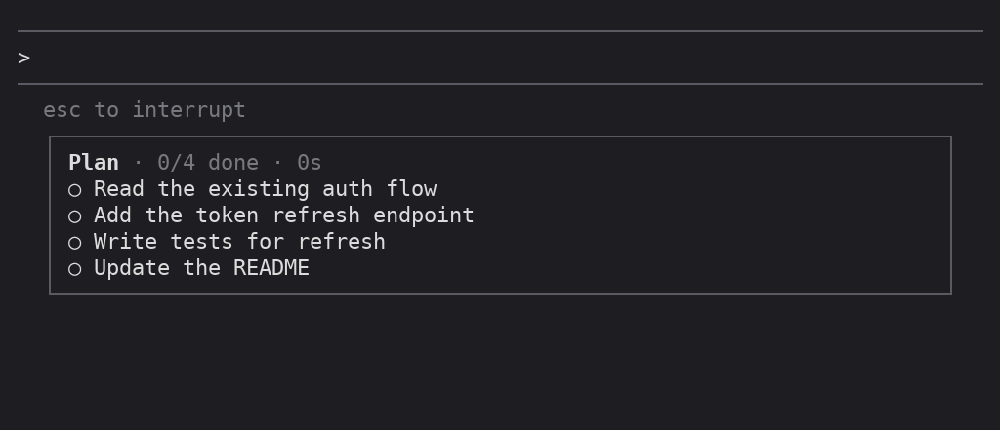

# clawd-tasks

[](https://github.com/itsomidho/clawd-tasks/releases) [](https://github.com/itsomidho/clawd-tasks/wiki)

A task board for [Claude Code](https://claude.com/claude-code). When Claude makes a plan, the board lists its tasks under the prompt and, under the task in progress, the steps Claude takes for it: each tool call, what it worked on, and how long it ran.

With [clawd-statusbar](https://github.com/itsomidho/clawd-statusbar) installed, the board sits right above or below the bar, in a frame of the same width. Each plugin works on its own.



<sub>One real plan, recorded: Claude reads the cart code, adds applyCoupon, then writes a test; the first test run fails and the second passes. Once every task is done, the board leaves the screen.</sub>

## What it shows

| | |
|---|---|
| `Plan · 2/4 done · 1m 16s` and a bar | how far the plan is, and how long it has run |
| `✓` `●` `○` | done, in progress, not started |
| `4m 05s` | how long the task took, or has taken so far |
| `+48 −3` | lines the task added and removed |
| `2 agents` | agents the task started |
| `│ Read tests/AuthTest.php` | the steps of the task in progress: the tool and what it worked on; red when it failed |

When every task is done the board leaves the screen; the next plan brings it back.

The plan comes from Claude's own task list (`TodoWrite`, or `TaskCreate` and `TaskUpdate`). In a session that has neither, the plugin gives Claude a tool of its own, `plan`, to keep the plan on the board; where they exist, that tool waits behind tool search so Claude is not offered two ways to do one thing. Calls a subagent makes are filed under the task in progress too, marked `(agent)`. Calls made while no task is in progress are counted at the bottom.

Line counts come from what Claude sent to the edit tools, so they are close, not a `git diff`.

## Requirements

- Claude Code with plugin hooks (built and tested on 2.1.300)
- Nothing else: no scripts, no network, no tools to install

## Install

In Claude Code, type:

```
/plugin install clawd-tasks --marketplace itsomidho/claude-plugins
```

Answer `y` to add the marketplace if asked, then choose a scope. The [`itsomidho` marketplace](https://github.com/itsomidho/claude-plugins) also lists [clawd-statusbar](https://github.com/itsomidho/clawd-statusbar); each plugin works on its own.

From a shell: `claude plugin install clawd-tasks --marketplace itsomidho/claude-plugins`.

## Commands

| | |
|---|---|
| `/board` | hide or show the board (in a pane: open it) |
| `/board export` | print the plan as Markdown and copy it to the clipboard, for an MR description |
| `/board clear` | empty the board |
| `/board close` | hide the board (in a pane: close it) |

`/clear` empties the board too.

## Settings

Open `/plugin`, pick clawd-tasks, and set:

| Setting | Default | |
|---|---|---|
| Where | `prompt` | `prompt`: under the prompt, beside clawd-statusbar if you have it. `pane`: in a pane that docks beside the conversation in fullscreen |
| Open the pane on a plan | on | with Where set to `pane`: open it by itself when Claude writes a plan of two or more tasks, on a terminal 144 columns or wider |

## How it works

The plugin (`hooks/register.tsx`) watches each tool call as it runs. Calls to the plan tools (`TodoWrite`, `TaskCreate`, `TaskUpdate`, and the plugin's own `mcp__clawd-tasks__plan`) update the board's tasks; every other call becomes a step under the task most recently set in progress, timed from start to end, with its file and line counts for the edit tools and an agent count for `Agent`. The rules live in `hooks/board.ts` as plain functions, which the tests in `hooks/board.test.ts` cover; `hooks/register.test.tsx` draws the board under the prompt and calls the plan tool.

The board is kept in the session's state, so it survives a reload of the plugin. Under the prompt it is drawn by a hook on the hint line there, in a frame sized as clawd-statusbar sizes its own; it lists up to six tasks (past that the done ones fold into one line) and the last three steps, so it stays short. A new plan shows it again if you hid it, and a finished plan takes it away. Nothing leaves your machine.

## Troubleshooting

**The board doesn't show.** It appears only once Claude makes a plan, so ask for work with a few steps ("make a plan and then …"). If it still doesn't show:

- `/board` hides and shows it; you may have hidden it. A new plan shows it again too.
- With Where set to `pane`, the board is in a pane: `/board` opens it.
- After installing or updating, restart Claude Code. The plan tool, which Claude needs in a session without `TodoWrite` or `TaskCreate`, reaches Claude only once the plugin loads at a session's start.

**`/tasks` shows background tasks, not the board.** `/tasks` is Claude Code's own command. Since 0.4.0 the board's command is `/board`; 0.3 asked for `/tasks`, was refused, and in that refusal also lost the plan tool, so the board never filled. Update: `claude plugin update clawd-tasks@itsomidho`, then restart Claude Code.

**`Host key verification failed` on install or update.** Claude Code fetched the plugin from GitHub over SSH, and this machine has no SSH key for GitHub. Either add one (`ssh-keygen -t ed25519`, add it to your GitHub account, then `ssh -T git@github.com` once to accept GitHub's host key), or have git use HTTPS for GitHub:

```
git config --global url."https://github.com/".insteadOf git@github.com:
```

Installing from a shell (`claude plugin install …`) also falls back to HTTPS by itself; updating does not.

**`/board` is listed twice, or the board draws twice.** Two copies of the plugin are loaded, such as the installed one and a working copy started with `--plugin-dir`. Run one: start Claude Code without `--plugin-dir`, or disable the installed copy with `/plugin` while you work on yours.

**The board is above the status bar, not below it (or the other way round).** The two plugins each add their frame under the prompt, and their order depends on which one Claude Code loads first; neither plugin can choose it.

## Development

```
claude plugin validate .
claude plugin test .
```

`docs/board.gif` is a recording of a real session.

To run your working copy instead of the installed one, start Claude Code with `claude --plugin-dir /path/to/clawd-tasks`; edits reload when a turn ends.

## The clawd family

clawd-tasks is one of seven plugins in the [`itsomidho` marketplace](https://github.com/itsomidho/claude-plugins); each works on its own:

- [clawd-statusbar](https://github.com/itsomidho/clawd-statusbar): a framed status bar under the prompt: context, usage limits with reset times, git state, MR/PR pipeline status, and Clawd frying an egg while Claude works
- [clawd-guard](https://github.com/itsomidho/clawd-guard): a safety net: stops risky shell commands, writes to secret files and leaked keys before they run
- [clawd-notify](https://github.com/itsomidho/clawd-notify): tells you when Claude is done or needs you: a desktop notification, a chime, and optionally a push to your phone
- [clawd-git](https://github.com/itsomidho/clawd-git): a live git panel beside the conversation: the file tree, changes, colored diffs and the commit graph; marks what Claude changed, stages, commits and asks Claude to review
- [clawd-logs](https://github.com/itsomidho/clawd-logs): watches your project's error logs (WordPress debug.log, nginx, any log file): new errors show above the prompt, grouped, with a Fix button, and Claude hears about the ones its own work caused
- [clawd-debug](https://github.com/itsomidho/clawd-debug): a step debugger beside the conversation: set a breakpoint, let Claude run your code with test data, and step line by line while every variable and line value shows

## License

MIT
